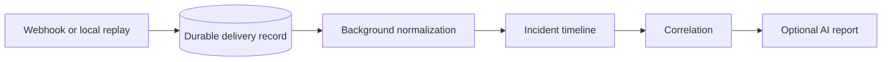

# SignalTrail

**Evidence-backed incident investigation.** SignalTrail combines pull requests, CI checks and deployments into one incident timeline and links every finding to its evidence. It keeps observed facts, deterministic correlations and hypotheses clearly separate.

> **Status:** early development, following a 6-week roadmap (see below). The core demo replays a synthetic outage and needs no external credentials.

## The problem

When a release fails, on-call engineers have to piece together what changed across pull requests, CI checks and deployments, often under pressure. They need:

- one ordered timeline of everything that changed
- correlations that say how strong they are (same commit vs. just close in time)
- suggestions they can check against real evidence

SignalTrail provides that timeline and never presents a match as proof of cause.

## Demo workflow

1. Replay a synthetic checkout outage
2. Open the related deployment and CI check
3. See why a same-commit match is stronger than a time-only match
4. Generate a mock investigation report and reject one suggested check
5. Replay duplicate webhook deliveries and see the timeline stay correct

## Planned features

- Replay of a synthetic outage, plus signed webhooks from an authorized GitHub test repository
- Workspace-scoped timeline with stable ordering, source IDs and provenance
- Correlations by repository, commit SHA, deployment and time window
- Mock investigator by default, with validation that every cited evidence ID belongs to the incident
- Review decisions on suggested checks, with an audit trail
- Search, evidence comparison and keyboard-accessible review

## Tech stack

| Layer | Technology |
|---|---|
| Frontend | Next.js, TypeScript |
| API | Fastify |
| Database | PostgreSQL, Prisma |
| Queue | Redis, BullMQ |
| Local environment | Docker Compose |
| Testing | Vitest, Playwright |

## Architecture



**Core entities:** Workspace, RepositoryConnection, WebhookDelivery, NormalizedEvent, Incident, CorrelationRun, InvestigationRun, ReviewStep, AuditEntry.

## Design rules

- Webhook signatures are verified, and duplicate deliveries produce exactly one event.
- Accepted work is never lost, even if the queue fails after the database commit (outbox pattern).
- Every report cites evidence IDs that belong to the incident; unknown IDs are rejected.
- Correlations are labeled by strength and never claimed as cause.
- SignalTrail never runs production actions.
- Viewers can't write, and workspaces can't read each other's records.

## Roadmap

| Week | Focus | Status |
|---|---|---|
| Week 1 | **W01-01 + CI** — Bootstrap TypeScript workspace with Compose stack, add synthetic event fixtures and contract test | ✅ Done |
| Week 2 | **Storage & webhooks** — Add workspaces, memberships and repositories, store events, verify webhook signatures, deduplicate deliveries, normalize events in a worker | Planned |
| Week 3 | **Incidents & rules** — Add incident API, paginate incident timelines, add evidence view, match deploys by exact SHA, add time-window rules with provenance | Planned |
| Week 4 | **Investigator & review** — Add mock investigator with bounded evidence, validate citations, add review decisions and permissions, record review history | Planned |
| Week 5 | **Search & reliability** — Add incident search, add outbox with bounded retries, recover failed jobs | Planned |
| Week 6 | **Release** — Add traces and ingest metrics, add benchmarks and tenant-isolation tests, package containers and write runbooks, add end-to-end tests, demo assets and release notes | Planned |

## Getting started

Prerequisites: Node.js 20 (see `.nvmrc`), pnpm 9 and Docker with Compose.

```bash
cp .env.example .env
pnpm install
pnpm deps:up      # PostgreSQL 16 and Redis 7 on 127.0.0.1
set -a; . ./.env; set +a   # export DATABASE_URL for Prisma
pnpm db:deploy    # apply database migrations
pnpm db:seed      # two synthetic workspaces; prints an API token per demo user
pnpm typecheck
pnpm test
pnpm fixtures:validate   # check every synthetic event fixture
pnpm dev          # web on :3000, API on :4000 (GET /health)
```

The API authenticates with `Authorization: Bearer <token>`. Workspace roles are `viewer` (read), `maintainer` (also connect repositories) and `owner` (also manage members); a workspace always keeps at least one owner. Requests for a workspace you are not a member of get the same 404 as an unknown workspace.

| Endpoint | Role |
|---|---|
| `GET/POST /v1/workspaces` | any signed-in user (the creator becomes owner) |
| `GET /v1/workspaces/:id`, `GET …/members`, `GET …/repositories[/:repoId]` | viewer |
| `GET …/events[/:eventId]` (timeline order; `limit`, `cursor`, `kind`, `commitSha`, `repositoryId`) | viewer |
| `POST …/repositories`, `DELETE …/repositories/:repoId` | maintainer |
| `POST …/events` (up to 500 replayed fixture events) | maintainer |
| `POST …/members`, `PATCH/DELETE …/members/:userId` | owner |

Stored events follow the contract in `packages/contracts` and are append-only. An event is identified by its ID and by its source object (source, kind and source ID), so sending it again returns `duplicate`, and reusing either with different content returns `conflict` and keeps the stored event. Over HTTP only replayed fixture events from connected repositories are accepted; GitHub events will arrive through signed webhooks. A repository that has events cannot be disconnected. `pnpm db:seed` stores the `checkout-outage` fixture in `ws_demo`.

CI (`.github/workflows/ci.yml`) runs the same steps on every push to `main` and every pull request: a frozen-lockfile install, typecheck, tests, fixture validation and build, plus a job that starts the Compose stack and checks PostgreSQL and Redis respond.

| Path | Purpose |
|---|---|
| `apps/web` | Next.js UI |
| `apps/api` | Fastify API |
| `apps/worker` | Background normalization worker (BullMQ) |
| `packages/contracts` | Normalized event contract (Zod), stable timeline ordering and the synthetic `checkout-outage` fixture |
